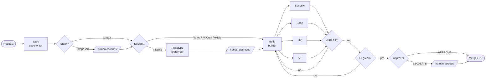

# Concept and vision

**English** · [Deutsch](konzept.de.md)

## The idea in one sentence

**Software is made in a fixed, checkable process of roles – and a person decides where it matters.**

Factory is not a code generator. It is a **way of working** that good teams have, carried over to AI agents: whoever wants something describes it. Someone turns it into a spec. Someone builds. Others review, each through their own lens. Someone approves. Every step leaves a file behind.

It grew out of practice: **more than 110 jobs** in three products in education, from editor configuration to single-sign-on hardening, about **85 % of them merged**. What follows is what held up.

## Six principles

### 1. Files, not conversation
Agents get only a job id and paths. Everything else – request, spec, reviews, decisions – lives in files in the job folder. That makes every step **repeatable**, every state **diffable** and every job **traceable** months later. An interrupted run picks up where the files are.

### 2. Separate the roles
Whoever builds does not review. Four reviewers see the same change **independently** and only through their lens: security, code, UX, UI. At the end an approver checks for itself instead of trusting the reports. The security review always runs on the strongest model; small jobs may be built faster and cheaper.

### 3. Look first, then judge
The UI review **renders** every changed page at 375 and 1280 px, clicks the new controls and puts its screenshots next to the design. Every finding names its evidence: a line of code, a measured number or a screenshot. "Feels generic" is not a finding.

### 4. People in the right places
Not everywhere, but reliably where it counts:
- **Stack** – before the first product code is built.
- **Design** – before a new screen is implemented.
- **Human gate** – for auth, secrets, permissions, data deletion and migration, always.
- **Escalation** – when the approver hesitates or something is still open after two rework rounds.

Everything in between runs through.

### 5. One core, many projects
The agents are **generic**. What makes a project special – users, guidelines, design system, data rules – lives in the repo's **profile**. Projects use the factory as a plugin at a **fixed version** instead of copying agent files. Copies drift apart, silently and surely: two copies of the same agent prompt differed by more than 200 lines after a few months, and each had improvements the other lacked.

### 6. The same process, whoever starts it
Whether a developer types `/factory next` in a chat, a Jira ticket gets a label or a ticket PR is merged: **stages, roles, reviews and state format are the same.** The flavour only decides who starts it, where people answer, and whether the factory runs watched or in the background.

## The process

## Structure

| Layer | Where | What |
|---|---|---|
| **Core** | this repo | process (`skills/factory`), eight roles (`agents/`), preflight check, board, secret scan, templates |
| **Flavour** | `flavours/`, `templates/workflows/` | how it runs: `local`, `jira`, `ticket-pr` |
| **Profile** | `factory/profile.md` in the project | users, guidelines, design source, extra rules per role |
| **Jobs** | `factory/jobs/` in the project | one folder per job, one state file per job |
| **Skills** | separate marketplaces | domain knowledge that roles and people both use |

## Design in the spec process

Design is **part of the spec**, not an afterthought in review. The `## Design` section names source and status:

| Source | When | What the factory does |
|---|---|---|
| **Figma** | The team designs in Figma | The spec names file and frames; pinned token export in the repo; with the Figma MCP the factory reads the frames directly |
| **FigCraft** | Open, self-hosted design tool | The spec names document and frames; tokens as with Figma |
| **Prototype** | There is no design yet | The prototyper builds a click-through prototype with every state; a person approves it; it becomes the reference for the build, the UI review and future jobs |

So the UI lens does not check against taste but **against an approved reference**.

## Vision

**Today:** a factory that takes features in single repos from request to merge – in a chat or in the background.

**Next:**
- **One factory for a whole portfolio.** A harness repo runs the factory for several product repos, with jobs across repo boundaries and one end-to-end criterion.
- **Learning from every run.** Run logs and reviews flow back: which findings keep recurring? Which profile rule is missing? Proposals for profile and prompts arrive as PRs.
- **Visible cost.** Tokens and run time per job and role on the board.
- **Design in the flow.** Figma and FigCraft frames, token snapshot and prototypes as one strand: changes to the design create jobs of their own.

**The goal:** teams describe what they need and decide what is good enough. **The assembly-line work in between is done by the factory – visible, checkable and the same in every project.**
