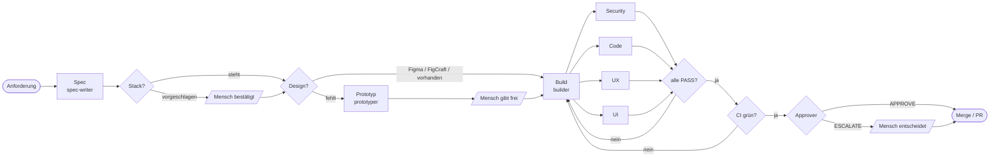

# Konzept und Vision

## Die Idee in einem Satz

**Software entsteht in einem festen, prüfbaren Ablauf aus Rollen – und ein Mensch entscheidet dort, wo es darauf ankommt.**

Die Factory ist kein Code-Generator. Sie ist ein **Arbeitsablauf**, wie ihn gute Teams haben, übertragen auf KI-Agents: Wer etwas will, beschreibt es. Jemand klärt es zu einer Spec. Jemand baut. Andere prüfen, jede mit ihrer eigenen Brille. Jemand gibt frei. Jeder Schritt hinterlässt eine Datei.

Entstanden ist sie in der Praxis: **über 110 Jobs** in drei Produkten im Bildungsbereich, von der Editor-Konfiguration bis zur Single-Sign-on-Härtung, rund **85 % davon gemergt**. Was hier steht, ist das, was sich dabei bewährt hat.

## Sechs Prinzipien

### 1. Dateien statt Gespräch
Agents bekommen nur eine Job-ID und Pfade. Alles andere – Anforderung, Spec, Reviews, Entscheidungen – steht in Dateien im Job-Ordner. Das macht jeden Schritt **wiederholbar**, jeden Stand **diffbar** und jeden Job auch nach Monaten **nachvollziehbar**. Ein abgebrochener Lauf setzt dort wieder auf, wo die Dateien stehen.

### 2. Rollen trennen
Wer baut, prüft nicht. Vier Reviewer sehen dieselbe Änderung **unabhängig voneinander** und nur durch ihre Linse: Sicherheit, Code, UX, UI. Ein Approver prüft am Ende selbst nach, statt den Berichten zu glauben. Die Sicherheitsprüfung läuft immer auf dem stärksten Modell; kleine Jobs dürfen schneller und günstiger gebaut werden.

### 3. Erst ansehen, dann urteilen
Die UI-Prüfung **rendert** jede geänderte Seite bei 375 und 1280 px, klickt die neuen Bedienelemente und legt ihre Screenshots neben das Design. Jedes Urteil nennt seinen Beleg: eine Zeile Code, eine gemessene Zahl oder einen Screenshot. „Wirkt generisch“ ist kein Befund.

### 4. Menschen an den richtigen Stellen
Nicht überall, aber zuverlässig dort, wo es zählt:
- **Stack** – bevor das erste Produktcode-Paket gebaut wird.
- **Design** – bevor ein neuer Bildschirm umgesetzt wird.
- **Human Gate** – bei Auth, Secrets, Berechtigungen, Datenlöschung und -migration, immer.
- **Eskalation** – wenn der Approver zögert oder nach zwei Nacharbeitsrunden noch etwas offen ist.

Alles dazwischen läuft durch.

### 5. Ein Kern, viele Projekte
Die Agents sind **allgemein**. Was ein Projekt besonders macht – Nutzer, Richtlinien, Design-System, Datenregeln –, steht im **Profil** des Repos. Projekte binden die Factory als Plugin in einer **festen Version** ein, statt Agent-Dateien zu kopieren. Kopien laufen auseinander, still und sicher: Zwei Kopien desselben Agent-Prompts unterschieden sich nach wenigen Monaten in über 200 Zeilen, und jede hatte Verbesserungen, die der anderen fehlten.

### 6. Derselbe Ablauf, egal wer startet
Ob eine Entwicklerin im Chat `/factory next` tippt, ein Jira-Ticket ein Label bekommt oder ein Ticket-PR gemergt wird: **Stufen, Rollen, Reviews und Zustandsformat sind dieselben.** Der Flavour legt nur fest, wer anstößt, wo Menschen antworten und ob die Factory zuschauend oder im Hintergrund läuft.

## Der Ablauf

## Aufbau

| Schicht | Wo | Was |
|---|---|---|
| **Kern** | dieses Repo | Ablauf (`skills/factory`), acht Rollen (`agents/`), Prüfskript, Board, Secret-Scan, Vorlagen |
| **Flavour** | `flavours/`, `templates/workflows/` | Betriebsart: `local`, `jira`, `ticket-pr` |
| **Profil** | `factory/profile.md` im Projekt | Nutzer, Richtlinien, Design-Quelle, Zusatzregeln je Rolle |
| **Jobs** | `factory/jobs/` im Projekt | ein Ordner je Job, eine Zustandsdatei je Job |
| **Skills** | eigene Marketplaces | Fachwissen, das Rollen und Menschen gleichermaßen nutzen |

## Design im Spec-Prozess

Design ist **Teil der Spec**, nicht ein Nachgedanke im Review. Der Abschnitt `## Design` nennt Quelle und Status:

| Quelle | Wann | Was die Factory tut |
|---|---|---|
| **Figma** | Das Team gestaltet in Figma | Spec nennt Datei und Frames; gepinnter Token-Export im Repo; mit Figma-MCP liest die Factory die Frames direkt |
| **FigCraft** | Offenes, selbst gehostetes Design-Werkzeug | Spec nennt Dokument und Frames; Tokens wie bei Figma |
| **Prototyp** | Es gibt noch kein Design | Der Prototyper baut einen Klick-Prototyp mit allen Zuständen; ein Mensch gibt ihn frei; er wird zur Referenz für Build, UI-Review und künftige Jobs |

So prüft die UI-Linse nicht gegen Geschmack, sondern **gegen eine freigegebene Vorlage**.

## Vision

**Heute:** Eine Factory, die in einzelnen Repos Features von der Anforderung bis zum Merge bringt – im Chat oder im Hintergrund.

**Als Nächstes:**
- **Eine Factory für ein ganzes Portfolio.** Ein Harness-Repo betreibt die Factory für mehrere Produkt-Repos, Jobs über Repo-Grenzen hinweg mit einem End-to-End-Kriterium.
- **Lernen aus jedem Lauf.** Run-Logs und Reviews fließen zurück: Welche Befunde wiederholen sich? Welche Profilregel fehlt? Vorschläge für Profil und Prompts kommen als PR.
- **Kosten sichtbar machen.** Tokens und Laufzeit je Job und Rolle auf dem Board.
- **Design im Fluss.** Figma- und FigCraft-Frames, Token-Snapshot und Prototypen als ein Strang: Änderungen am Design erzeugen selbst Jobs.

**Das Ziel:** Teams beschreiben, was sie brauchen, und entscheiden, was gut genug ist. **Die Fließbandarbeit dazwischen macht die Factory – sichtbar, prüfbar und in jedem Projekt gleich.**
